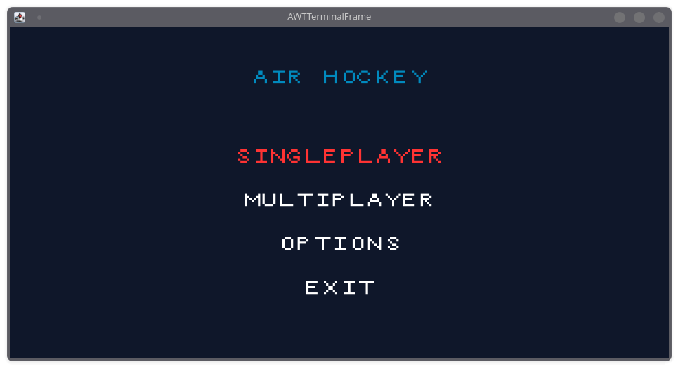
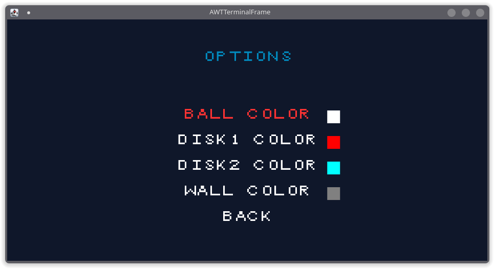
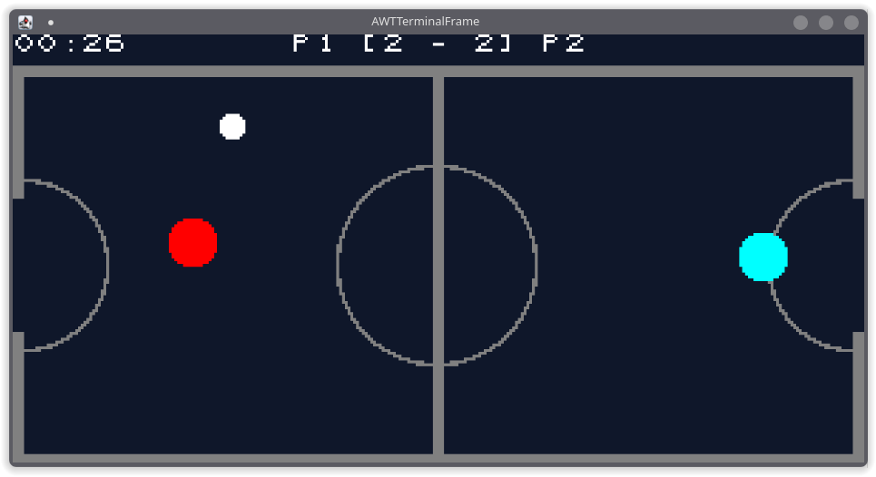
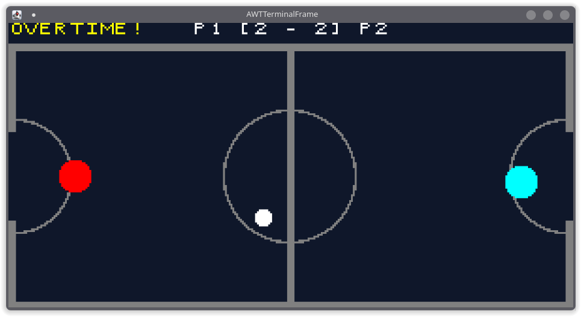
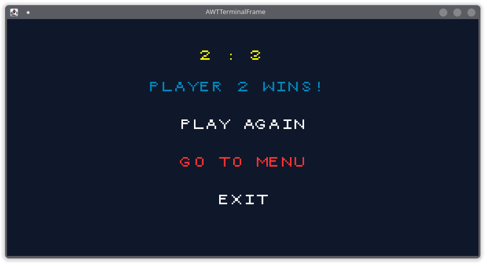

# LDTS_T06_G08 - AirHockey 

## Game Description

AirHockey is a classic arcade game for 1 or 2 players where each one of them control a disk and their goal is to score on the opponents net.
Best of 7 goals decide the winner. If, once the timer hits 1 minute of playing, the players hold the same score, the game proceeds to an "Overtime" where the winner is the first one to score.

This game was developed by João Morete (up202403406@up.pt), Luís Sampaio (up202404078@up.pt) and Tomás Silva (up202403435@up.pt).

For a more detailed version of this description click [here](docs/README.md).

## Screenshots

The following images show the general look of our game and its menus:

### Menus

 
  *Fig. 1 - Main Menu*

  *Fig. 2 - Options Menu*

### Game

  *Fig. 3 - Game*

  *Fig. 4 - Overtime*

### End Game

  *Fig 5 - End Menu*
